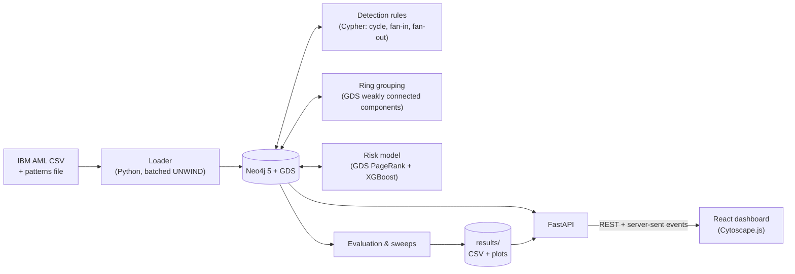

# Fraud-ring detection in payment networks

Payment fraud often runs through networks of mule accounts. Money is split, passed
along chains of accounts, cycled back and recombined. Each transfer looks normal on
its own; the fraud only shows in the shape of the network. This project stores
transactions as a graph in Neo4j and finds suspicious ring patterns (cycles,
fan-in, fan-out) with Cypher. It groups the flagged accounts into rings with Graph
Data Science, scores accounts with an XGBoost model, and shows everything on a web
dashboard that explains why each account was flagged.

**Research questions**

- **RQ1.** Do graph-derived features improve fraud detection over transaction-only features?
- **RQ2.** Which laundering patterns do rule-based graph queries catch, and which need machine learning?

## Data

IBM *Transactions for Anti-Money Laundering* (AMLworld), **HI-Small** variant, from Kaggle:
5,078,345 transactions between 515,088 accounts over 18 days (2022-09-01 to 2022-09-18).
5,177 transactions (0.10%) are labelled laundering. The patterns file groups 3,209 of
them into 370 typed attempts (CYCLE, FAN-IN, FAN-OUT, GATHER-SCATTER, SCATTER-GATHER,
BIPARTITE, STACK, RANDOM); the other 1,968 have no pattern type. Both files serve as ground
truth.

### Graph model

```
(:Account {id: "bank:account", bank, account, in_degree, out_degree, risk_score, pagerank})
(:Account)-[:SENT {tx_id, timestamp, amount, currency, amount_received, receiving_currency,
                   amount_usd, format, is_laundering, is_self_loop, pattern, attempt_id}]->(:Account)
(:Alert {rule, reason, tx_ids, start, end, total_usd, risk})-[:INVOLVES {role}]->(:Account)
(:Alert)-[:PART_OF]->(:Ring {size, alert_count, total_usd})<-[:IN_RING]-(:Account)
```

- Accounts are keyed by bank plus account number, since 8 account numbers appear under two banks.
- `amount_usd` uses exchange rates derived from the dataset's own cross-currency rows (median per currency).
- `is_laundering`, `pattern` and `attempt_id` are labels. Rules and model features never read them.
- Self-loops (11.6% of rows, mostly reinvestments) are loaded but ignored by the rules.

## Architecture



Everything runs locally with Docker Compose: `neo4j`, `api`, `frontend` (nginx), plus
`neo4j-test`, which only the test script starts.

## Setup

Requirements: Docker Desktop (about 4 GB of memory for its VM is enough), Python 3.11+,
and Node 18+ for frontend development only.

```sh
# 1. Data: put HI-Small_Trans.csv and HI-Small_Patterns.txt into data/raw/
# 2. Configuration
cp .env.example .env                  # then set NEO4J_PASSWORD
# 3. Database (the GDS plugin downloads on first start)
docker compose up -d neo4j
# 4. Python environment
python -m venv .venv
.venv/Scripts/pip install -e "backend[dev,ml]"   # Windows; .venv/bin/pip elsewhere
```

Then build everything, from `backend/`:

| Step | Command | Time on a laptop |
|---|---|---|
| Load the graph | `python -m fraudring.ingest.load --reset` | ~16 min |
| Check the load | `python -m fraudring.ingest.verify` | ~1 min |
| Run detection (alerts + rings) | `python -m fraudring.detection.run` | ~12 min |
| Evaluate the rules | `python -m fraudring.evaluation.rules` | < 1 min |
| Train the risk model | `python -m fraudring.ml.train` | ~6 min |
| Threshold sweep (optional) | `python -m fraudring.detection.sweep` | ~1.5 h |

For faster iteration, `load --until 2022-09-03` loads only the first two days. Prefer
it over `--limit N`: the CSV is only roughly time-ordered, so taking the first N rows
cuts laundering patterns in half.

Finally, start the whole stack:

```sh
docker compose up -d --build
```

- Dashboard: http://localhost:8080
- API docs: http://localhost:8000/docs
- Neo4j Browser: http://localhost:7474

## Demo

1. Open http://localhost:8080. **Alerts** lists the detected alerts ranked by risk, each with a one-line reason.
2. Choose a pattern (Cycle, Fan-in or Fan-out) and click **Simulate fraud ring** in the top bar.
   A synthetic ring is written into the graph, and detection runs only on its transactions.
   About 2 to 6 seconds later a banner reports the alert.
3. Click **View ring →**. The ring explorer draws the money flow, with amounts and times on the arrows.
   The side panel shows why each account was flagged, for example
   *"Part of a 5-hop cycle: $7,591 left SIM:a0018900 and $7,002 came back 100 min later…"*.
4. Click any account to see its risk score, its alerts and its recent transfers.
5. **Live feed** replays the dataset in time order. Transfers covered by an alert are highlighted,
   and simulated rings appear in the feed as soon as they are injected.
6. **Metrics** shows the evaluation tables and plots below.
7. Remove the synthetic data with `curl -X DELETE http://localhost:8000/simulate`.

`python -m fraudring.replay --start 2022-09-05 --rate 20` shows the same feed in a terminal.

## Detection rules

| Rule | Flags | Defaults |
|---|---|---|
| Cycle | money leaves an account and returns: time-ordered hops, each passing on a USD amount within ±20% of the previous one | ≤ 12 hops, within 96 h |
| Fan-in | one account receives from many distinct senders in a sliding window | ≥ 8 senders within 96 h |
| Fan-out | one account sends to many distinct receivers in a sliding window | ≥ 8 receivers within 96 h |

The thresholds come from a sweep (`results/sweep_*.csv`, `results/sweep_*.png`) that
measured three things for each setting: ground-truth capture, runtime and alert volume.

- **Cycle:** runtime barely changes with the hop limit, because the first expansion
  dominates, so 12 hops costs no more than 4. At 96 h the rule captures 47 of 54 ground-truth
  cycles. The 7 it misses are not time-ordered chains (5) or break the amount tolerance (2).
  A 120 h window adds no captures but about 25% more alerts. A ±30% tolerance adds none
  either and gives 66% more alerts; ±10% loses 7 cycles.
- **Fans:** ≥ 8 counterparties is the knee of the curve. Moving from ≥ 5 to ≥ 8 cuts
  flagged accounts by 65% (fan-in) and 77% (fan-out), for 20 and 6 points of capture.
  Fan rules skip 15 high-volume hubs (over 1,000 edges, up to 168k).

The amount tolerance is what keeps 12-hop cycle search tractable. Only about 5% of random
time-ordered hop pairs pass it, so branching drops from about 7 to about 0.35 per hop.

Rings are weakly connected components of the core accounts (cycle members and fan hubs).
They are linked only by transactions that belong to the alerts on both ends. Counterparties
join rings but cannot merge them; looser rules produced a single "ring" of 67k accounts.

## Results

### Rule-based detection vs labels (per transaction)

| Rule | Flagged tx | Precision | Recall (all laundering) | Recall (pattern-typed) | F1 (all) |
|---|---:|---:|---:|---:|---:|
| Cycle | 1,271 | 31.1% | 7.6% | 11.7% | 0.122 |
| Fan-in | 76,916 | 1.4% | 20.7% | 26.0% | 0.026 |
| Fan-out | 188,035 | 0.4% | 16.1% | 25.9% | 0.009 |
| **Any rule** | 265,560 | 0.9% | **43.9%** | **62.9%** | 0.017 |

Recall by pattern type, for any rule (`results/rule_eval_by_pattern.png`):

| Pattern | FAN-IN | GATHER-SCATTER | CYCLE | FAN-OUT | SCATTER-GATHER | RANDOM | BIPARTITE | STACK | untyped |
|---|---:|---:|---:|---:|---:|---:|---:|---:|---:|
| Transactions flagged | 88% | 85% | 84% | 84% | 84% | 10% | 8% | 8% | 13% |

### Account risk model (RQ1)

Label: the account sent or received any laundering transaction (6,357 of 515,088 accounts, 1.23%).
XGBoost with default settings and `scale_pos_weight` for the imbalance, on a stratified 80/20 split, with a 0.5 threshold.

- **Tabular features:** transaction counts, distinct counterparties, total and mean USD in/out, and the number of currencies and payment formats used.
- **Graph features:** in a detected ring, which rules flagged the account, and PageRank.

| Model | Precision | Recall | F1 | PR-AUC |
|---|---:|---:|---:|---:|
| Tabular only | 5.1% | 64.2% | 0.095 | 0.228 |
| Tabular + graph | 5.7% | 67.3% | 0.106 | **0.280** |

The plot is in `results/ml_pr_curve.png`, and the top features are in `results/ml_feature_importance.csv`.

### Answers

- **RQ1.** Yes, moderately. Adding graph features raises PR-AUC from 0.228 to 0.280
  (+23% relative), and precision is higher at every recall level up to about 0.6. The
  rule-derived flags (fan-in, fan-out, in-ring, cycle) all rank among the ten most
  important features. Precision at the default threshold stays low, though, because
  laundering accounts are only 1.2% of the data.
- **RQ2.** The rules work well for the shapes they encode. They flag 84–88% of the
  transactions in CYCLE, FAN-IN, FAN-OUT, SCATTER-GATHER and GATHER-SCATTER attempts,
  and cycles are precise (31%). Fan rules are very imprecise, because many ordinary
  accounts have 8+ counterparties within four days. BIPARTITE, STACK and RANDOM attempts,
  and untyped laundering, are mostly missed (8–13%). These lack a single hub or closed
  loop, so catching them takes learned or richer features.

## Why a graph database: one cycle query, two ways

The cycle rule as a compact Cypher pattern: a path from an account back to itself, with
time-ordered hops, a 96-hour window and similar amounts on each hop.

```cypher
MATCH p = (a:Account)-[rs:SENT*2..12]->(a)
WHERE all(i IN range(0, size(rs) - 2) WHERE
          rs[i].timestamp <= rs[i + 1].timestamp
          AND abs(rs[i + 1].amount_usd / rs[i].amount_usd - 1) <= 0.2)
  AND rs[-1].timestamp <= rs[0].timestamp + duration({hours: 96})
RETURN a.id AS origin, size(rs) AS hops, [n IN nodes(p) | n.id] AS path
```

The same rule in SQL, over a table `transfers(src, dst, ts, amount_usd)`, needs a
recursive common table expression. The query carries the walk's state by hand: origin,
current account, last timestamp and amount, and the visited path as a string.

```sql
WITH RECURSIVE walk (origin, current_acct, start_ts, last_ts, last_usd, hops, path) AS (
    SELECT src, dst, ts, ts, amount_usd, 1, '/' || src || '/' || dst || '/'
    FROM transfers
    WHERE src <> dst
  UNION ALL
    SELECT w.origin, t.dst, w.start_ts, t.ts, t.amount_usd, w.hops + 1,
           w.path || t.dst || '/'
    FROM walk w
    JOIN transfers t ON t.src = w.current_acct
    WHERE w.current_acct <> w.origin                       -- stop once back at the origin
      AND w.hops < 12
      AND t.ts >= w.last_ts                                -- time-ordered hops
      AND t.ts <= w.start_ts + INTERVAL '96' HOUR          -- window
      AND t.amount_usd BETWEEN 0.8 * w.last_usd AND 1.2 * w.last_usd
      AND (t.dst = w.origin
           OR POSITION('/' || t.dst || '/' IN w.path) = 0) -- no revisits
)
SELECT origin, hops, path FROM walk WHERE current_acct = origin AND hops >= 2;
```

Both are correct, but they differ in where the work happens:

- **Each hop.** In Neo4j a hop follows the current account's own relationships, so its
  cost depends on that account's degree, not on the size of the table. In SQL each
  recursion level is a join back into the whole `transfers` table. It can be fast with
  an index on `(src, ts)`, but every level still materialises an intermediate result.
- **State.** Paths, node identity and "already visited" are part of the Cypher language.
  In SQL they are hand-encoded columns and string tricks.
- **Readability.** The Cypher pattern reads like the rule's definition. The SQL encodes
  how to walk the graph.
- **Algorithms in place.** Ring grouping (WCC) and PageRank run in the same database with
  GDS, with no export step.

This comparison is written, not benchmarked. Also, the production query
(`backend/fraudring/detection/cycles.py`) writes the hops out explicitly instead of using
`*2..12`, so that each branch is pruned as soon as one hop fails a condition.
A variable-length pattern checks those conditions only after building whole paths,
which does not scale past about three hops on this graph.

## Tests

Unit tests run without a database. Rule and API tests use a throwaway `neo4j-test`
container. Run them through the script, which stops the main database first: on a 4 GB
Docker VM the two databases do not fit in memory together.

```sh
bash scripts/db-tests.sh        # stops neo4j, runs pytest on neo4j-test, restarts neo4j
```

## Repository layout

```
backend/fraudring/
  ingest/       CSV + patterns parsing, USD rates, batched loader, verification
  detection/    cycle and fan rules, alerts, GDS rings, threshold sweep, runner
  evaluation/   rule precision/recall vs labels
  ml/           graph + tabular features, XGBoost comparison, risk scores
  api/          FastAPI app
  simulate.py   synthetic ring injection with targeted detection
  replay.py     time-ordered transaction replay for the live feed
backend/tests/  parser, rule, ring and API tests
frontend/       React + Vite dashboard (Cytoscape.js), served by nginx
results/        evaluation CSVs and plots
scripts/        db-tests.sh
```

## Limitations

- **Synthetic data.** AMLworld is generated by a simulator. Patterns are cleaner and
  labels more complete than in real payment data, and there is no real UPI or bank data
  here. Results show what the methods can do, not how they would perform in production.
- **Thresholds were tuned on the evaluation data.** The sweep chose thresholds by
  looking at ground-truth capture on the same dataset the rules are evaluated on, so the
  rule results are optimistic. There is no separate tuning period.
- **The rules are narrow by design.** Time-ordered cycles miss loops whose hops are out of
  order, and the ±20% amount tolerance misses cycles with large conversions or fees.
  Fan rules are imprecise and skip the 15 largest hubs.
- **The model is minimal.** It uses default hyperparameters, a single split, a 0.5
  threshold and an account-level label. An account counts as positive if it touched any
  laundering transaction, which includes some innocent counterparties. Risk scores in the
  database are out-of-fold predictions.
- **The live feed is a replay.** It streams already-loaded transactions; batch detection
  has already run over them, and detection does not rerun as they arrive. Only simulated
  rings are detected live, and their rings are attached incrementally (a full run may
  regroup them).
- **Runtimes are single runs on one laptop.** That's an 8 GB machine with a 4 GB Docker VM.
  They are indicative, not a benchmark.
- **Alert risk mixes two scales.** Alerts from batch detection use the model's risk score.
  Newly simulated alerts fall back to their rule's measured precision until the model is
  retrained.
